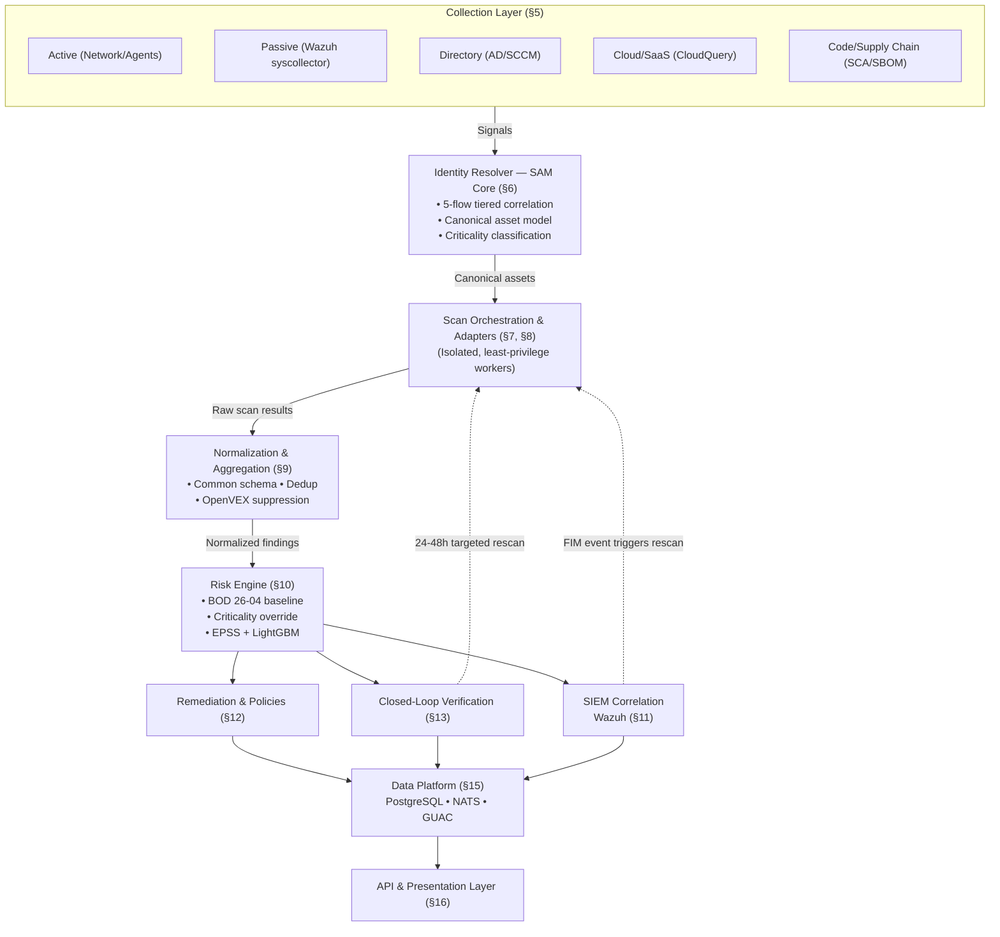
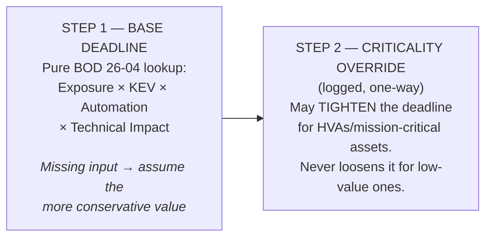

# Vulnerability & Asset Management Platform — Final Architecture

**Status:** Final v1.0
**Scope:** An open-source VM + SIEM platform — asset discovery, vulnerability detection, risk-based prioritization, remediation workflow, closed-loop verification, and real-time SIEM correlation. An alternative to Positive Technologies MaxPatrol VM/SIEM or Tenable.sc, built on an open-source stack rather than a proprietary one.

---

## Table of contents

1. [Core principle: asset-centric, not scan-centric](#1-core-principle-asset-centric-not-scan-centric)
2. [Design principles](#2-design-principles)
3. [Requirements traceability](#3-requirements-traceability)
4. [High-level architecture](#4-high-level-architecture)
5. [Collection / discovery layer](#5-collection--discovery-layer)
6. [Identity resolver — asset correlation & SAM core](#6-identity-resolver--asset-correlation--sam-core)
7. [Scan orchestration layer](#7-scan-orchestration-layer)
8. [Scanner adapter layer](#8-scanner-adapter-layer)
9. [Normalization & aggregation layer](#9-normalization--aggregation-layer)
10. [Risk scoring engine](#10-risk-scoring-engine)
11. [SIEM correlation layer (Wazuh)](#11-siem-correlation-layer-wazuh)
12. [Remediation workflow & elimination policies](#12-remediation-workflow--elimination-policies)
13. [Closed-loop verification layer](#13-closed-loop-verification-layer)
14. [Secrets exposure & supply-chain blast radius](#14-secrets-exposure--supply-chain-blast-radius)
15. [Data architecture](#15-data-architecture)
16. [API layer & presentation layer](#16-api-layer--presentation-layer)
17. [Cross-cutting concerns](#17-cross-cutting-concerns)
18. [How this differs from a commercial VM platform](#18-how-this-differs-from-a-commercial-vm-platform)
19. [Roadmap](#19-roadmap)
20. [Open risks & questions](#20-open-risks--questions)
21. [Appendix: tool & license reference](#21-appendix-tool--license-reference)

---

## 1. Core principle: asset-centric, not scan-centric

This is the single decision that separates a next-generation platform from a scanner with a dashboard bolted on, and it governs every design choice below.

A traditional scanner (Nessus-class) operates in a **scan paradigm**: a vulnerability is only known once you re-scan for it. A next-generation platform operates in an **asset paradigm**: the platform maintains a persistent, continuously-updated model of every asset and every piece of installed software across the environment. When a new CVE is disclosed, the platform checks it against the *existing* inventory instantly — no new scan required to know whether you're exposed. Scanning becomes a verification and enrichment step (confirming exploitability, reachability, patch status), not the primary discovery mechanism.

Every layer below exists to serve this principle: the Identity Resolver (§6) builds and maintains the asset model; the Normalization Layer (§9) keeps vulnerability data comparable across sources so it can be matched against that model; the Risk Engine (§10) re-evaluates priority the moment new disclosure data arrives, without waiting on a scan cycle.

---

## 2. Design principles

### Architectural principles

- **Integrate proven engines, don't re-implement detection.** Vulnerability signature databases and scan engines are decades of accumulated work (NVD, OSV, the Greenbone feed, Go's own vulnerability database). None of that gets rebuilt. Effort goes into orchestration, correlation, and scoring — the layer that's actually missing from the open-source ecosystem.
- **Asset identity is a first-class problem, not an afterthought.** The same host, container, or cloud resource is seen by multiple discovery paths at different times under different labels. A dedicated identity-resolution layer (§6) merges these into one canonical record instead of leaving deduplication to whoever built the last connector.
- **The loop closes automatically.** A finding marked "resolved" is treated as a hypothesis, not a fact, until a re-scan confirms it. This is built into the core data model from day one (§13), not bolted on as a later-phase feature.
- **Scoring is transparent and adjustable, not a black box.** Every risk score decomposes into named factors (BOD 26-04 variables, EPSS, KEV status, SSVC, asset criticality, exposure, a learned adjustment) that can be inspected, and the learned component retrains on analyst feedback rather than staying static.
- **Nothing is a single point of vendor lock-in.** Every scanner, every feed, every ticketing system sits behind an adapter interface. Swapping Greenbone for a different network scanner, or Jira for ServiceNow, should not touch core logic.
- **Integrated engines are untrusted, sandboxed components — not extensions of this platform's trust boundary.** A scanner adapter gets only the credentials and network access its specific job needs, and its own supply chain (container digest, template feed, release channel) is a tracked, ongoing input, not a one-time integration decision. Every tool in §8 runs against untrusted input by design; treating that boundary as porous is how a vulnerability scanner becomes the highest-leverage way to compromise the environment it's supposed to protect. (This isn't hypothetical — see §7 and §17.)

### Operational principles

- **Async over sync in any hot path.** Nothing that runs on every alert or every event should block on an outbound network call. Where this platform needs to inject judgment into Wazuh's alerting, it does so by pre-loading data Wazuh can check locally (a CDB list), not by making Wazuh wait on an API call.
- **Wazuh is the source of truth for "this happened." This platform is the source of truth for "does this matter."** Detection and enrichment/suppression are different concerns with different latency and correctness requirements — conflating them inside the SIEM's alert pipeline creates a single point of failure for both.
- **Fail open on alerting, never open on suppression.** If a lookup fails or times out, the safe default is to let the alert through at its original severity, not to suppress it. Suppression is a stronger claim than escalation and requires higher confidence.
- **Verify before auto-escalating to Critical.** Any automated pipeline step that can raise something to Critical severity — a secret match, a reachability finding — should require corroborating evidence, not a single pattern match. Unconfirmed signals route to human review, not to an automatic page.

### Non-goals (explicitly out of scope for v1)

- Competing with dedicated SAST tools (Semgrep, CodeQL) on proprietary code analysis depth — this platform ingests their output rather than replacing them.
- Building a proprietary scan engine or vulnerability signature database.
- Full EDR/XDR-style endpoint response — this is a management and visibility platform, not a response platform.
- OT/ICS scanning — genuinely different problem (different protocols, much higher blast-radius-of-a-bad-scan risk than IT scanning), left out deliberately rather than silently.

---

## 3. Requirements traceability

Mapping the original brief to where each concern is addressed in this document, so nothing gets lost as the design evolves:

| Original requirement | Addressed in |
|---|---|
| Asset-centric continuous inventory (not just scan-time discovery) | §1 Core principle, §6 Identity Resolver |
| Asset discovery & grouping (stale assets, shadow IT) | §5 Collection / discovery layer |
| Asset identity resolution & deduplication | §6 Identity Resolver (5-flow tiered correlation) |
| Asset criticality weighting (business context) | §6 Identity Resolver criticality classification, §10 Risk scoring two-step model |
| Custom risk scoring (reduce alert fatigue) | §10 Risk scoring engine (BOD 26-04 + LightGBM) |
| Vulnerability prioritization (regulatory compliance) | §10 BOD 26-04 four-variable model |
| OpenVEX noise elimination | §9 Normalization layer |
| Remediation workflow / MTTR | §12 Remediation workflow & elimination policies |
| Closed-loop validation | §13 Closed-loop verification layer |
| SIEM / real-time detection correlation | §11 SIEM correlation layer (Wazuh) |
| Secrets exposure & blast-radius correlation | §14 Secrets exposure & supply-chain blast radius |
| Supply-chain provenance tracking | §14 Sigstore/SLSA attestation |

---

## 4. High-level architecture



### Build vs. integrate

| Layer | Approach | Primary technology |
|---|---|---|
| Discovery — repos & hosts | Build | Go services per source type |
| Discovery — cloud & Kubernetes | Integrate | CloudQuery (sync to Postgres) + Steampipe (ad-hoc live query) |
| Discovery — passive/endpoint | Integrate | Wazuh syscollector |
| Discovery — directory import | Build | AD/SCCM/hypervisor connectors |
| Identity resolution | Build | Go, 5-flow tiered resolver (§6) |
| Scan orchestrator | Build | Go, message-queue-backed job scheduler, dispatches to isolated scan workers (§7) |
| Network/host scanning | Integrate | Greenbone/OpenVAS, Nuclei — digest-pinned |
| Container/SBOM scanning (point-in-time) | Integrate | Trivy, Grype, Syft — digest-pinned, isolated workers |
| SBOM scanning (continuous) | Integrate | OWASP Dependency-Track, consuming SBOMs Syft already produces |
| SCA (code & dependencies) | Integrate | Ecosystem-native tools + OSV-Scanner V2 |
| Normalization | Build | Common finding schema, Go |
| Aggregation & dedup | Integrate | DefectDojo |
| OpenVEX noise elimination | Integrate + build | Trivy/Grype native VEX consumption + programmatic VEX generation via `openvex/go-vex` |
| Software-composition graph | Integrate | GUAC (Postgres-backed) — source → artifact → vulnerability |
| Runtime relationship graph | Build | Postgres adjacency / recursive CTEs — artifact → running instance → host |
| Risk scoring — BOD 26-04 baseline | Build | Four-variable deterministic model + two-step criticality override |
| Risk scoring — intra-tier ranking | Build | EPSS v5 + Python, LightGBM |
| SIEM correlation | Integrate | Wazuh (CDB lists + correlation rules) |
| Secret detection | Integrate | Gitleaks (pattern) + live-credential verifier |
| Supply-chain provenance | Integrate | Sigstore/cosign, SLSA attestations |
| Remediation workflow | Integrate + build | Jira/ServiceNow APIs + SLA logic + elimination policies |
| Closed-loop verification | Build | Scheduler triggering §7/§8 |
| Secrets management | Integrate | OpenBao |

---

## 5. Collection / discovery layer

Asset and vulnerability signal reaches the platform through four independent channels, deliberately kept separate because they have different trust levels, latency characteristics, and coverage gaps that only overlap in combination.

### 5.1 Repository discovery

- **Mechanism:** SCM API integration (GitHub/GitLab/Bitbucket) as an org-level app or scoped token. List repositories, inspect each for manifest files (`package.json`, `go.mod`, `pyproject.toml`, `Cargo.toml`, `Gemfile`) to tag ecosystem(s) present.
- **Trigger model:** webhook-driven (repo created, push to default branch) rather than polling — repositories are cheap to watch in real time.
- **Identity key:** repository URL/slug. Low churn, the easiest identity problem in the system.
- **Ownership signal:** CODEOWNERS file, repo topics/metadata — feeds directly into asset criticality tagging.

### 5.2 Cloud & Kubernetes discovery

- **Mechanism:** CloudQuery (MPL-2.0) syncing AWS/Azure/GCP/Kubernetes configuration into this platform's own PostgreSQL instance on a schedule, rather than hand-rolled SDK connectors per provider. Steampipe (AGPLv3 core CLI/FDW, Apache-2.0 plugins) is the companion tool for ad-hoc, live-query investigation during incident response — same underlying provider APIs, a different access pattern (query-time API calls instead of a synced store).
- **Why integrate instead of build:** maintaining SDK-level connectors for AWS/Azure/GCP/Kubernetes across hundreds of resource types is exactly the kind of "decades of accumulated work" §2 says not to rebuild. CloudQuery already normalizes this into queryable SQL tables; effort goes into what to do with the data (identity resolution, criticality tagging) instead of re-deriving it from provider APIs.
- **Caveat worth tracking:** CloudQuery's core framework and SDK are open source (MPL-2.0), but some of its official provider plugins have started moving to a paid model. Check plugin-level licensing per cloud provider before committing, and keep the `CloudDiscoveryAdapter` behind the same interface pattern as §7/§8 so a paid plugin can be swapped for a community one or a hand-rolled connector without touching anything downstream.
- **Credential model:** a read-only cross-account role per AWS account (STS AssumeRole) or per-subscription service principal for Azure, configured as CloudQuery/Steampipe connections. Credential fan-out across accounts/subscriptions is still the actual engineering problem here, more than the querying itself.
- **Cadence:** event-driven off CloudTrail/EventBridge (or Azure Activity Log) for near-real-time creation/deletion, **plus** a periodic full reconciliation pass — events get missed or arrive out of order, and catching that drift is the whole point of a VM platform.
- **Identity key:** cloud resource ARN / resource ID. Ownership from tags (`Environment`, `Owner`, `DataClassification`) — tag-hygiene enforcement is worth building as a companion feature, since untagged resources are exactly the "shadow IT" the original brief called out.

### 5.3 Host discovery

Host discovery is three overlapping techniques, not one:

- **Active scanning** — nmap/masscan sweeps on a schedule (reuses the network scanner from §8).
- **Passive observation** — Zeek/NetFlow catching hosts that never answer a probe (firewalled, or scan-averse legacy systems).
- **Agent-based reporting** — Fleet/osquery heartbeats, plus AD/LDAP bulk sync for domain-joined machines.

**Identity is the hard part here.** IP address is not a stable key: DHCP and NAT mean the same host appears under different IPs over time, and the same IP can belong to different hosts at different times. The canonical key needs to be a hardware UUID, an agent-assigned ID, or a MAC+domain composite — with a reconciliation step that merges "nmap saw 10.0.1.42," "the Fleet agent reported hostname X," and "AD has a computer object for X" into one asset record instead of three duplicate ones. The full resolution logic is in §6.

### 5.4 Container discovery

Split into two sub-problems:

- **Registry discovery** — enumerate pushed images via the registry API, webhook on push.
- **Runtime discovery** — watch the Kubernetes/Docker API for what's actually running.

Containers themselves are too ephemeral to be *the* asset — a pod can live for seconds. **The image digest (SHA) is the asset**; a running pod is a pointer to it. Mapping digest → currently-running pods/clusters gives blast-radius data for free when a vulnerability is found in that image.

**Cross-layer link:** OCI image labels (`org.opencontainers.image.source`) can tie an image back to the repository that built it, connecting the repository asset type (§5.1) to the container asset type. This is the seed of the *software-composition* side of the asset relationship graph in §15 — it's also exactly the shape of link GUAC's own ingestion model is built around, which is why §15 leans on GUAC rather than building this correlation from scratch.

### 5.5 Passive / endpoint discovery (Wazuh)

When an endpoint joins the network or authenticates, the Wazuh agent's `syscollector` module captures host telemetry — hostname, IP, MAC, OS, installed packages. A Wazuh custom integration script posts this straight to the Identity Resolver (§6) as a new or updated asset signal. This gives near-real-time inventory without running noisy active network sweeps, and it's the fastest-refreshing, least-intrusive source available — it tells you a host exists and roughly what's on it, without requiring a separate active scan.

### 5.6 Directory & infrastructure import

Directory services (Active Directory, SCCM, hypervisor management planes) bring in assets the platform would otherwise never see directly, especially endpoints managed through traditional enterprise infrastructure. These are imported-collection sources — they don't actively probe the environment but they provide authoritative identity signals (domain SIDs, computer objects, hypervisor instance IDs) that strengthen the Identity Resolver's correlation.

### 5.7 Code & supply-chain collection

SCA scanners (OSV-Scanner V2, govulncheck), SBOM generation (Syft) and continuous SBOM monitoring (Dependency-Track), and secret scanners (Gitleaks) feed the same pipeline from the software side rather than the infrastructure side. Details in §8 (scanner adapters) and §14 (secrets/supply-chain).

All channels report into the Identity Resolver (§6) as raw, source-tagged signals. None of them independently decides what an asset "is" — that judgment belongs entirely to the next layer.

---

## 6. Identity resolver — asset correlation & SAM core

This is the component that makes the asset-centric paradigm from §1 possible, and it's the platform's most architecturally important piece — more important, in terms of long-term value, than any individual scanner.

### 6.1 Responsibilities

- **Correlation & deduplication.** The same physical or logical asset is frequently reported by multiple sources under different identifiers — an agent reports a hostname, a network scan reports an IP, a cloud import reports an instance ID. The Identity Resolver reconciles these into one canonical asset record using the 5-flow tiered correlation model below.
- **Per-asset software inventory.** For every canonical asset, the resolver maintains a current list of installed software and versions, sourced from whichever collection channel last reported it. This inventory is what makes instant vulnerability applicability possible — a new CVE disclosure for a given package/version is checked against this list directly, without waiting for a scan cycle.
- **Asset criticality classification.** Not all assets matter equally. The resolver tags each asset with a business-impact tier (informed by data classification, exposure, and role — a public-facing payment endpoint outranks a dev sandbox). This tier feeds directly into the Risk Engine's two-step model (§10).
- **Change tracking.** New, previously-unseen assets and assets that have gone stale (no signal in N days) are both surfaced explicitly — an unexpected new asset appearing on the network is itself a security signal worth surfacing, not just inventory housekeeping.

### 6.2 Resolver interface

Every discovery path in §5 produces partial identity signals for the same underlying asset. A dedicated resolution layer sits between the connectors and the asset store, implemented as a resolver interface with one implementation per signal type:

```go
type IdentitySignal interface {
    SignalType() string          // "mac_address", "agent_uuid", "cloud_arn", "image_digest", "fqdn"
    Value() string
    Confidence() float64
}

type AssetIdentityResolver interface {
    // Resolve merges a new signal against existing asset records,
    // returning the canonical asset ID it belongs to (creating one if none match).
    Resolve(ctx context.Context, signal IdentitySignal) (assetID string, err error)
}
```

Each signal type carries a different confidence weight (an agent-reported UUID is near-certain; an IP address alone is weak evidence), and the resolver's merge logic is where duplicate-asset bugs get fixed in one place instead of in every connector. This is the single most impactful piece of infrastructure in the discovery layer — skipping it is what makes most self-built inventory systems drown in duplicate assets within a few months.

### 6.3 5-flow tiered asset correlation

There are two ways to get correlation wrong, and they're not equally dangerous. A **false split** (one real asset tracked as two records) just inflates counts and creates duplicate tickets — annoying, but self-correcting once someone notices. A **false merge** (two real assets treated as one) is worse and quieter: patch one host and the platform silently marks a *different* host's vulnerability as resolved too, because it thinks they're the same thing. The correlation logic below is built to bias hard against false merges, even at the cost of occasionally leaving a false split for a human to clean up.

#### Flow 1: Tiered matching — deterministic, then probabilistic, then human

Matching runs in three strict tiers, never blended into one score. **Deterministic** rules — exact matches on stable, authoritative identifiers (cloud instance ID, hardware serial number, TPM/hardware UUID) — auto-merge immediately; these identifiers essentially can't collide by accident. **Probabilistic** matching (weighted scoring across hostname similarity, subnet, OS fingerprint, first-seen timestamp proximity) handles the large fuzzy middle where no single field is decisive on its own. Anything that doesn't clear a high-confidence threshold in either tier — **heuristic** territory — routes to a manual-review queue instead of auto-merging.

Only the deterministic tier is allowed to merge without a review trail. Everything below that confidence level gets merged provisionally but flagged, so a human can catch a bad match before it corrupts vulnerability history.

#### Flow 2: Block before you match

Exhaustively comparing every asset record against every other one doesn't scale — it's quadratic. Records are first grouped into coarse "blocks" (same subnet, same cloud account, same OS family) and matching only runs *within* a block, not across the whole inventory. This is a performance necessity, not just an optimization — without it, correlation either falls behind the collection rate or starts skipping comparisons silently. It keeps the deterministic/probabilistic matching in Flow 1 fast enough to run continuously rather than as an overnight batch job.

#### Flow 3: The two identifiers that will burn you

MAC address and IP address are the two fields every naive asset-matching design reaches for first, and both degrade in ways that aren't obvious until they cause a false merge:

- Modern iOS and Android devices randomize their MAC address by default on wireless networks, so the same physical device can legitimately show up under several different MACs — treating MAC as a stable identifier for BYOD/wireless clients creates false splits.
- DHCP lease churn, ephemeral cloud IPs, and overlapping private address space across NAT'd or VPN-connected sites all mean the same IP can legitimately belong to two genuinely different hosts at different times or locations — trusting IP alone as a match key is exactly how you get a false merge.

Neither field is disqualified outright, but neither is trusted alone. MAC and IP live in the probabilistic tier, weighted alongside other signals, never in the deterministic tier — and any match resting primarily on IP similarity gets a shorter confidence half-life (the match is more likely to be *stale* the older it is), since IP reassignment is a when-not-if.

#### Flow 4: Merges are reversible, or they're a liability

Every merge and split is logged with full lineage — which source records went in, what confidence tier decided it, and a path back to the pre-merge state. Relationships (which findings, which scan history, which criticality tier) are carried forward explicitly, not just attributes — a merge that keeps the hostname but drops the vulnerability history is worse than no merge at all.

A false merge caught a week later needs to be *un-mergeable* without losing the audit trail of why it happened in the first place. This is what makes the correlation layer trustworthy enough to auto-merge aggressively in Flow 1 — aggressive automation is only safe when its mistakes are cheap to reverse.

#### Flow 5: Staleness isn't deletion

An asset with no signal from any collection channel for a defined window (days, tuned per asset class — a laptop going quiet over a weekend is normal, a server going quiet is not) gets flagged and eventually archived, never hard-deleted. This keeps the active inventory clean without destroying the historical record a compliance audit or an incident investigation might need six months later.

---

## 7. Scan orchestration layer

A Go service responsible for turning "here is a newly-discovered or re-scan-due asset" into "the right scanner ran against it and results came back."

- **Job queue:** NATS or Kafka between the orchestrator and scan workers, so engines scale independently of discovery volume.
- **Routing logic:** the orchestrator inspects an asset's type and detected ecosystem(s) and dispatches to the matching adapter(s) — a host gets the network scanner, a repository with a `pyproject.toml` gets the Python SCA adapter, a container image gets the SBOM/container adapters, and so on. An asset can match multiple adapters (a repo with both `package.json` and a `Dockerfile` gets both SCA and container scanning).
- **Adapter interface:**

```go
type ScannerAdapter interface {
    Supports(asset Asset) bool
    Scan(ctx context.Context, asset Asset) (FindingsBatch, error)
    Name() string
}
```

Every engine in §8 implements this interface. Adding a new scanner, or swapping one out, means writing one adapter — nothing upstream or downstream changes.

- **Execution model.** Adapters do not run in-process or as ambient subprocesses on a shared host. Each scan job launches its adapter inside an isolated, least-privilege worker — a short-lived container or sandboxed subprocess with only the credentials and network egress that specific asset's scan actually requires. This is a direct response to the March 2026 Trivy/`trivy-action` compromise: a scanner running with full pipeline credentials and unrestricted egress isn't a vulnerability-scanning risk, it's a blast-radius risk. The adapter interface above already made "swap this scanner" cheap; this makes "this scanner got compromised" survivable instead of catastrophic.
- **Supply-chain hygiene for the scanner engines themselves.** Every scanner container/binary in §8 is pinned by immutable digest, never a mutable tag — tags can be, and were, rewritten in place during the March 2026 incident. Template/signature feeds (Nuclei templates, the OpenVAS community feed) are pulled on a vetted cadence rather than always-latest, and this platform subscribes to each upstream project's own security advisories (Aqua/Trivy, ProjectDiscovery/Nuclei) as an operational input — the same way it already tracks CVE feeds.
- **Scheduling windows:** network/active scans against production hosts run on defined maintenance windows or throttled concurrency limits; passive and agent-based signals flow continuously; SCA/repo scans run on push (near-instant) plus a nightly full sweep to catch newly-disclosed CVEs in unchanged dependencies (largely superseded for SBOM-tracked components by Dependency-Track's continuous monitoring — see §8).

---

## 8. Scanner adapter layer

| Category | Tooling | Notes |
|---|---|---|
| Network & host | Greenbone/OpenVAS, Nuclei | GPL-licensed free community feed for OpenVAS; Nuclei for fast templated CVE/misconfig checks. Both digest-pinned; template/signature feed pulled on a vetted cadence (§7). |
| Container & SBOM (point-in-time) | Trivy, Grype, Syft | Container images, IaC misconfiguration, SBOM generation (CycloneDX/SPDX). Digest-pinned, run in isolated workers (§7). Both natively ingest OpenVEX documents (Trivy via `--vex`, Grype via built-in VEX filtering) for noise reduction before results reach the normalization layer. |
| SBOM (continuous monitoring) | OWASP Dependency-Track | Ingests the CycloneDX SBOMs Syft already produces and watches them continuously against NVD/OSV/GHSA — catches a newly-disclosed CVE in an *unchanged* dependency without waiting for the next nightly Trivy/Grype sweep. Natively syncs findings into DefectDojo, so it slots into §9's aggregation path rather than adding a second one. |
| Code & dependencies (SCA) | Ecosystem-native tools + OSV-Scanner V2 fallback | See routing table below |
| Compliance/config (later phase) | OpenSCAP, Lynis, or Prowler + Powerpipe | CIS Benchmark-style auditing. Prowler/Powerpipe is worth evaluating alongside OpenSCAP/Lynis — it reuses the Steampipe data already flowing in from §5.2 instead of standing up a separate collection path. |
| Secret detection (pattern stage) | Gitleaks (or maintained successor) | Fast, offline, pre-commit/CI gate. Detection only — not proof of a live credential. See §14 for the full two-stage pipeline. |

### SCA routing table (which tool runs against which manifest)

| Manifest detected | Native tool | Notes |
|---|---|---|
| `pyproject.toml` / `uv.lock` | `uv audit` | OSV-backed, native to uv; falls back to `pip-audit` for non-uv projects |
| `go.mod` | `govulncheck` | Reachability-aware — only flags vulnerabilities actually reachable through the call graph. This factor matters more, not less, as NVD's CVSS coverage shrinks (§10) — it's evidence about the finding itself, independent of whether any external body has scored it yet. |
| `package.json` / lockfiles | `npm audit` | Checks against the GitHub Advisory Database |
| `Cargo.toml` | `cargo audit` | Rust-native |
| `Gemfile` | `bundler-audit` | Ruby-native |
| Multi-language / no clear single ecosystem | OSV-Scanner V2 | Cross-ecosystem fallback backed by OSV.dev. V2 adds layer-aware container image scanning (Debian/Ubuntu/Alpine) and guided remediation for npm and Maven, plus deps.dev-backed transitive dependency scanning for Python `requirements.txt` (v2.3.5+). |

Each adapter runs inside its isolated worker (§7) as a subprocess (or via its library where one exists), captures JSON output, and passes it to the normalization layer. Ecosystem-native tools are preferred over the polyglot fallback because they produce fewer false positives through ecosystem-specific version matching — the polyglot tools exist for coverage, not as the default.

---

## 9. Normalization & aggregation layer

### Common finding schema

Every adapter's output gets mapped to one shape before anything downstream sees it:

```json
{
  "finding_id": "uuid",
  "asset_id": "uuid (resolved via §6)",
  "source_tool": "govulncheck",
  "vulnerability_id": "CVE-2025-xxxxx",
  "component": "golang.org/x/crypto",
  "component_version": "0.34.0",
  "cvss": {
    "score": 7.5,
    "version": "3.1",
    "vector": "CVSS:3.1/AV:N/AC:L/PR:N/UI:N/S:U/C:H/I:H/A:H",
    "source": "NVD | CNA | ADP | null"
  },
  "nvd_enrichment_status": "full | lowest_priority | not_scheduled",
  "epss": {
    "score": 0.42,
    "percentile": 0.91
  },
  "kev_listed": false,
  "ssvc": "track | track_star | attend | act | null",
  "vex_status": "not_affected | affected | fixed | under_investigation | null",
  "vex_justification": "vulnerable_code_not_in_execute_path | null",
  "first_seen": "timestamp",
  "last_seen": "timestamp",
  "status": "open | resolved | reopened | accepted_risk | suppressed_vex",
  "dedup_hash": "hash(asset_id + vulnerability_id + component)"
}
```

**Schema design notes:**

- `cvss` is explicitly optional per-CVE, not guaranteed. As of April 15, 2026, NIST reserves full NVD enrichment (independent CVSS, CPE mapping, CWE classification) for CVEs in the CISA KEV catalog, federal-use software, or EO-14028 "critical software" — an estimated 15–20% of new CVE volume. Storing version + full vector string (not a bare float) matters because CVSS v3.1 and v4.0 scores for the same CVE aren't numerically comparable, and v4.0 replaced the Temporal metric group with a Threat group.
- `nvd_enrichment_status` records which of NIST's three triage tiers a CVE landed in, so the Risk Engine (§10) can tell "not yet scored" apart from "will not be scored under the current policy" instead of treating a missing `cvss` field as a single undifferentiated null.
- `vex_status` and `vex_justification` capture OpenVEX assessment data, enabling automated suppression of non-affected findings before they reach the Risk Engine.

### OpenVEX noise elimination

Scanners flag CVEs in third-party dependencies even when the vulnerable code path is never compiled into, or executed by, your software. OpenVEX documents let upstream maintainers (or your own security team) publish a machine-readable statement that a given CVE is `not_affected`, with a justification such as `vulnerable_code_not_in_execute_path`.

Both Trivy and Grype natively ingest OpenVEX documents — use that native support directly for the common case of *consuming* upstream VEX statements. Reserve a custom integration (using `openvex/go-vex`) for the case where this platform needs to *generate* VEX statements programmatically — for instance, auto-issuing a `not_affected` statement the moment reachability analysis (e.g. `govulncheck`) proves a flagged function is never called in the build. When a CVE is confirmed `not_affected` this way, it automatically transitions to `suppressed_vex` status in the finding tracker without requiring manual developer triage.

### Dedup strategy

`dedup_hash` collapses findings reported by more than one tool for the same asset+component+CVE combination into a single record with multiple `source_tool` contributions — this is what prevents duplicate tickets in §12 when, say, both `govulncheck` and `OSV-Scanner` flag the same dependency.

### Aggregation backbone: DefectDojo

Rather than building an aggregation/dedup/workflow engine from scratch, this platform feeds normalized findings into **DefectDojo** (OWASP Flagship project, BSD-3-Clause), which already provides:

- Ingestion parsers for 200+ scanner output formats (useful even beyond this platform's own adapters, for ad-hoc tool results).
- A product hierarchy that ties a finding to an owning team/application rather than just a hostname.
- Built-in SLA rules and Jira/Slack integration hooks.

This platform's own code is responsible for getting normalized findings *into* DefectDojo correctly (via its API) and for the three things it doesn't do out of the box: the BOD 26-04 risk-scoring layer (§10), the learned intra-tier ranking (§10), and the automated re-scan trigger (§13). Worth noting: DefectDojo's own **Pro** tier added a paid risk-based prioritization engine in 2025. This platform deliberately keeps its own scoring layer in §10 instead — it's free, and inspectable down to the individual factor, which §2's transparency principle requires and a commercial add-on can't guarantee by default.

---

## 10. Risk scoring engine

This is the layer that balances regulatory compliance with operational efficiency. It's built as a **dual-model architecture**: CISA BOD 26-04 as the primary deterministic engine that produces SLA deadlines, and LightGBM as a secondary intra-tier ranker that helps analysts prioritize within a deadline bucket.

### Step 1: BOD 26-04 four-variable model (deterministic baseline)

CISA's Binding Operational Directive 26-04 (issued June 10, 2026) replaced CVSS-severity-based prioritization for federal agencies with a four-variable, risk-based model. It's worth adopting as the platform's core prioritization logic even outside a federal-compliance context, because every variable maps directly onto data this architecture already collects:

| Variable | Question it answers | Source in this architecture |
|---|---|---|
| Asset Exposure | Is the asset publicly reachable? | Computed by the platform — network topology is the one variable nobody outside the organization can supply |
| KEV Status | Is this CVE on CISA's Known Exploited Vulnerabilities catalog? | Cross-referenced against the KEV feed |
| Exploit Automation | Can an adversary automate every step of exploitation? | Ingested from NVD/CISA Vulnrichment (§10.2) rather than computed locally |
| Technical Impact | Partial or total control on successful exploitation? | CVSS impact sub-metrics, already flowing through the Normalization Layer |

The sixteen combinations of these four variables map to a remediation deadline tier, ranging from three calendar days (actively exploited, full control, automatable, publicly exposed) down to a routine fix-on-upgrade window for the least urgent combination.

**Fail-safe conservative defaults:** following CISA's own implementation guidance, the baseline computation uses fail-safe-conservative defaults wherever an input is missing: an asset with unresolved exposure status is treated *as if it were* publicly exposed, not given the benefit of the doubt; an unresolved automatability determination is treated as automatable. This step alone should reproduce CISA's published table exactly, which is the test for whether it's implemented correctly.

### Step 2: Asset-criticality override (tightens only, never loosens)

The naive approach of folding asset criticality straight into the BOD 26-04 score — multiplying the deadline by a criticality factor, or adding criticality as a fifth variable — breaks the thing that makes the model valuable: its four-variable matrix is deliberately simple enough to be **explainable**. Anyone can look at a finding and see exactly which four facts produced its deadline. Fold in a criticality multiplier and you've turned an auditable lookup table into a black-box score nobody can reconstruct by hand.

CISA's own implementation guidance keeps the base four-variable matrix criticality-blind on purpose, and handles asset importance as a **separate, explicit governance step** layered on top. This platform copies that pattern exactly:



A separate rule can shorten the Step 1 deadline for assets tagged high-value or mission-critical (from §6's asset-criticality tier) — and can *only* shorten it, never extend it for a low-criticality asset. Every application of this override is stored with the specific reason (which criticality tier, which asset) — this is the part that has to survive an audit question like "why did this CVE get fixed in 24 hours instead of the standard 14 days."

### EPSS: ranking within a tier, never overriding it

KEV status is a binary, observed signal: exploited or not. EPSS (FIRST.org, v5 as of June 2026) gives a daily-refreshed probability, between 0 and 1, that a given CVE will be exploited in the wild in the next 30 days. Use it to rank findings *within* a BOD 26-04 tier — deciding which of several "Attend"-level CVEs to fix first this week — not to override KEV status itself; a CVE with a high EPSS score but no confirmed exploitation is still a prediction, while KEV is an observation.

EPSS v5 was explicitly redesigned not to depend on NVD enrichment, using CNA/ADP data as a backup, so it can score a CVE sitting in NVD's "lowest priority" bucket with no CVSS at all. Weight it accordingly — it's closer to a required field than an optional enrichment now. For ingestion, pull FIRST's daily bulk CSV export on a schedule rather than querying the API per-CVE.

### Ingest, don't rebuild, the classification data

As of June 17, 2026, the NVD itself natively publishes CISA SSVC decision-tree data — including the Automatable and Technical Impact values — alongside structured "affected product" fields, as part of a database expansion. Pull this directly from the NVD API (or CISA's Vulnrichment feed) rather than building a local classifier for those two variables. The only variable that's genuinely yours to compute is Asset Exposure — nobody outside your organization knows your network topology — so that's where the Risk Engine's own logic should be concentrated.

### Additional baseline inputs

Beyond the four BOD 26-04 variables, the following signals enrich the baseline computation:

- **CVSS (base + threat/temporal), where available.** Sourced from NVD first; where NVD hasn't enriched a CVE, fall back to CNA-published CVSS/CWE (CVE Record Format v5, via the `cve.org` API or its `cvelistV5` GitHub mirror), or to CISA Vulnrichment's ADP data. Store version + full vector string per §9 — never average or compare v3.1 and v4.0 scores directly.
- **SSVC decision points** — sourced from CISA Vulnrichment's ADP container, already ingested alongside the Automatable/Technical Impact variables above. Costs a parser, not a new pipeline, and gives a structured triage signal that's still present for CVEs NVD has flagged lowest-priority.
- **Reachability** — where available (currently `govulncheck` for Go, extensible to other ecosystems), whether the vulnerable code path is actually invoked, not just present as a transitive dependency. This factor's relative value goes *up* as NVD's CVSS coverage shrinks — it's direct evidence about the finding itself, independent of whether any external body has scored it yet.

### SSVC buckets for stakeholder communication

Even with BOD 26-04's numeric deadlines driving the actual SLA clock, the plain-language SSVC buckets remain useful for dashboards and stakeholder reporting:

- **Track** — no action required now; remediate on the standard maintenance cadence.
- **Track\*** — specific characteristics warrant closer monitoring; standard SLA (~30 days).
- **Attend** — requires supervisory awareness and a scheduled fix (~7 days).
- **Act** — active exploitation against a critical asset; immediate, out-of-band remediation (within 24 hours).

### Learned tier: LightGBM intra-tier ranker (feedback-driven)

The baseline factors above — all BOD 26-04 variables, EPSS, CVSS (where available), reachability, asset criticality, exposure — become input features to a gradient-boosted classifier trained to predict a more specific target than the deterministic deadline alone: something like "will an analyst confirm this as a true priority" or "will this finding recur after being marked fixed." Include `nvd_enrichment_status` and CVSS-presence as explicit features — otherwise the model can quietly learn "this scored low" when the actual signal is "this was never scored," which is a different thing entirely.

This is a heavily imbalanced classification problem — most findings are low-priority noise — so the usual techniques apply: `scale_pos_weight` for class imbalance, conservative `num_leaves` to avoid overfitting on a training set that starts small, and close attention to the train/validation generalization gap as more labeled data accumulates.

The LightGBM score **ranks within a BOD 26-04 tier, never across tiers**. It answers "which of these twenty Attend-level CVEs should I fix first" — the same role EPSS plays, but trained on this organization's own analyst behavior rather than global exploitation data. EPSS and LightGBM are complementary intra-tier signals, not competitors.

**Feedback & retraining loop:** an analyst marking a finding as a false positive or overriding its priority is a label. Those labels accumulate into a relabeled dataset, trigger a scheduled retrain, and the retrained model is validated against false-positive-rate and recall thresholds on a held-out set before it replaces the production scorer — with a timestamped, rollback-capable deployment so a bad retrain never silently degrades scoring quality.

**Early-stage weight:** early on, with little labeled data, the baseline tier (BOD 26-04 + EPSS) should dominate the composite ranking, with the learned adjustment's weight increasing as confidence grows.

### Continuous re-evaluation

Because both steps are table lookups against live data, the deadline moves as facts change — removing a system from public exposure lengthens its window, a fresh KEV addition shortens it — consistent with the asset-centric, continuously-recomputed model in §1 rather than a static score assigned once at scan time.

### Output

A composite score plus a factor breakdown (not just a single number) — the point being that a security analyst can see *why* a finding scored the way it did, rather than trusting an opaque vendor score. The breakdown includes the BOD 26-04 tier, the criticality override (if applied, with reason), the EPSS rank, the LightGBM adjustment (with feature importances), and the SSVC bucket.

---

## 11. SIEM correlation layer (Wazuh)

Wazuh is the platform's real-time detection sensor network — this is the "SIEM" half of the "VM + SIEM" pairing, functioning the way MaxPatrol SIEM does alongside MaxPatrol VM: vulnerability context sharpens detections, and detections trigger reassessment.

### 11.1 Inbound: Wazuh as passive asset discovery

Covered in §5.5. Wazuh's `syscollector` telemetry feeds the Collection Layer with near-real-time host presence and package data, without an active sweep. A Wazuh custom integration script posts this straight to the Identity Resolver as a new or updated asset signal — a one-way, non-urgent push with no latency pressure, using the standard Wazuh Integrator model.

### 11.2 Outbound: vulnerability-aware alert escalation, without a synchronous bottleneck

**The goal:** when a network or WAF rule fires on an exploit attempt against a specific host, the SOC shouldn't have to guess whether that host is actually vulnerable and reachable. If it's already patched, the alert is noise; if it's not, it's the most important alert in the queue.

**Why this can't be a synchronous per-alert API call:** Wazuh's alert pipeline (rule match → alert generation → logging → downstream integrations) already has a defined shape, and the point where a third-party integration script runs is *after* the alert has been generated and leveled — there's no "pause and ask an external service before finalizing severity" step in that pipeline. Bolting a blocking HTTP call onto that path also creates a throughput risk: if the API is slow or unavailable, alerting for everything behind it queues up.

**The actual mechanism:**

- The Risk Engine continuously maintains a **CDB (constant database) list** — "hosts currently known to be vulnerable and reachable," keyed by IP and/or IP+CVE — and refreshes it on a short interval (tens of seconds to a couple of minutes, not real-time-per-event).
- A **Wazuh correlation rule** checks incoming alert fields against that CDB list *inside the rule engine itself*, at evaluation time. If the source or destination IP is on the list, the rule fires at an elevated level directly. This is a local, in-process check — no network call in the path of a single alert.
- Escalation happens this way, in Wazuh, using data pre-pushed by the platform.
- **Suppression works differently, and deliberately so.** Don't try to make Wazuh suppress an alert based on "patched or unreachable" — that's a stronger, riskier claim than escalation, and per §2's operational principles, judgment calls about what *doesn't* matter belong downstream in the platform's own SOC tooling / ticketing layer, where a human or a well-audited automated rule can apply that suppression with a visible trail, not silently inside the SIEM's alert stream.
- For the rare case where a genuinely on-demand lookup is needed rather than the periodically-refreshed CDB list, that call is allowed to exist — but it needs a short timeout, a circuit breaker, and a fail-open default (timeout or error → treat as vulnerable, don't suppress).

### 11.3 Event-driven closed-loop rescans

When Wazuh's File Integrity Monitoring detects a sensitive change — a SUID bit set, a webroot file modified — it emits an event onto the platform's message bus. The orchestrator (§7) picks this up and immediately queues a targeted, isolated scanner run against just that host/path, closing the loop between "something changed" and "we know whether that change introduced a new exposure" within seconds rather than waiting for the next scheduled scan. This mirrors MaxPatrol VM's own use of SIEM/NTA signal for continuous reassessment.

---

## 12. Remediation workflow & elimination policies

Detection and prioritization are only half the platform; the other half is closing the loop on fixing things and proving it happened — the piece that distinguishes a management *platform* from a scanner with a report export button.

- **Ticket creation:** findings above a configurable threshold generate tickets in Jira or ServiceNow via their APIs, pre-populated with asset owner, exploit status (KEV/EPSS/SSVC), the BOD 26-04 tier and computed deadline, affected component and version, and a suggested fix version where the scanner provides one.
- **SLA computation:** deadline is driven by the Risk Engine's two-step model (§10) — the BOD 26-04 tier adjusted for asset criticality — not a flat "critical = 7 days" rule. A KEV-listed, internet-facing, revenue-critical finding gets a materially shorter SLA than a low-EPSS finding on an internal dev box, even at the same nominal CVSS (or with no CVSS at all).
- **Elimination policies** — rules that automate what happens to a finding once conditions are met: auto-close on confirmed patch (verified by rescan or by the CDB list flipping to "no longer vulnerable"), auto-assign by asset owner or software vendor, auto-escalate on SLA breach. These replace the manual triage-mark-close cycle for the predictable, policy-driven cases.
- **Lighter-weight option:** for teams not running Jira/ServiceNow, an open ticketing backend (GLPI, Zammad) behind the same interface — the remediation layer talks to an abstract `TicketingAdapter`, not directly to a specific vendor API.
- **Ticketing integration:** findings flow into DefectDojo or SecObserve (or an external ticketing system) as the system of record for remediation work, rather than the vulnerability platform itself becoming a task tracker.
- **Escalation:** SLA breaches fire an alert to the asset owner and their manager on a configurable cadence, rather than silently aging out.
- **Vulnerability-aging and elimination-rate KPIs:** median time to remediate by severity tier, count of vulnerabilities open past their SLA deadline, and elimination rate trend over time, mirroring the dashboards a MaxPatrol VM or Tenable.sc operator would expect.

---

## 13. Closed-loop verification layer

The feature most VM deployments skip, and the cheapest one to build correctly:

- When a ticket/finding moves to "resolved," the orchestrator (§7) schedules a targeted re-scan of that specific asset+component 24–48 hours later — not a full asset re-scan, just enough to confirm the specific finding is gone.
- If the finding recurs, status flips to `reopened`, the original ticket is reopened (not a new duplicate ticket), and a note is attached explaining that the automated verification failed.
- Verification history feeds a "drift" metric per team — how often does "fixed" actually mean fixed — which is a genuinely useful executive-reporting number that most tools don't surface at all.
- This verification loop also feeds back into the LightGBM learned tier (§10) — findings that frequently recur after being marked fixed are a training signal for "will this finding recur," which is one of the model's prediction targets.

---

## 14. Secrets exposure & supply-chain blast radius

This subsystem correlates code-level findings with infrastructure impact — something neither a pure SIEM nor a pure code scanner does on its own.

### 14.1 Secret detection — two-stage, verification-gated

A hardcoded secret shouldn't be treated as an isolated code-quality finding. If Gitleaks (or equivalent) finds a hardcoded AWS key or database connection string, query the cloud asset inventory (via CloudQuery/NetBox) to find which production infrastructure that credential actually unlocks, and elevate the risk of both the code repository and the target asset together.

**The correction: gate the automatic escalation on verification, not just detection.** Fast pattern-based scanners answer "does this look like a secret" — a regex/entropy match, not proof the credential is live. Automatically firing a Critical-severity, dual-asset escalation off a raw pattern match will generate false positives from rotated keys, test fixtures, and expired credentials.

The two-stage pipeline:

1. **Detection (every commit/CI run):** fast pattern-based scanning (Gitleaks) catches the shape of a secret in milliseconds. Every hit is logged, but a hit alone does not trigger the blast-radius correlation.
2. **Verification (before any auto-escalation):** a live-credential-check step confirms the secret is actually active, via a safe, read-only API call to the relevant provider. Only a verified-live finding triggers the full blast-radius correlation — querying the cloud asset inventory to identify which production infrastructure that credential unlocks — and the automatic elevation of both the repository and the target infrastructure asset to Critical.
3. **Unverified pattern matches** route to a human-review queue at the Attend level — visible, tracked, but not paging anyone at 2 a.m. over a credential that may already be dead.

### 14.2 Image digest as the canonical software asset

In containerized environments, pods are ephemeral — they are never the asset. The **image digest** is, and scan history is retained under that digest as the canonical key in the asset database regardless of how many short-lived pods ever ran it. When a CVE is discovered against that digest weeks later, query the runtime registry logs to enumerate every pod that ever ran it, giving complete historical blast-radius reporting even though none of those pods still exist.

### 14.3 Supply-chain provenance

Extend the image-digest asset record with supply-chain provenance data: Sigstore/cosign signature and attestation data, and SLSA build provenance where available. This turns a blast-radius query for a newly disclosed CVE into an answer with two dimensions: what vulnerabilities this digest had, *and* whether the digest's own supply chain was verifiable in the first place. An unsigned image with an unknown build origin and a new Critical CVE is a different, more urgent problem than a signed, provenance-verified image with the same CVE.

---

## 15. Data architecture

### 15.1 System of record (PostgreSQL)

Assets, findings, scan_jobs, tickets, criticality tags, identity-resolution signals, and scan job state. DefectDojo's own schema handles a large portion of the findings/tickets side; this platform's schema owns assets, identity-resolution signals, and the Risk Engine's computed deadlines/tiers.

### 15.2 Message bus (NATS or Kafka)

The backbone for every event-driven flow: job orchestration between the scheduler and scan workers, FIM-triggered rescans (§11.3), CDB-list refresh signals (§11.2), secret-verification results (§14), new-KEV-entry re-evaluation triggers (§10). Nothing time-sensitive should depend on a polling loop where an event can drive it instead.

### 15.3 Object storage

Raw scan artifacts (full OpenVAS/Nuclei/Trivy output, generated SBOMs), OpenVEX documents, and Sigstore/SLSA attestations are stored as immutable documents alongside their database references — normalized findings live in Postgres, but the raw artifact is kept for audit/debugging, and some of this data (a full SBOM) doesn't belong inline in a relational row.

### 15.4 Asset relationship graph — hybrid

The relationship graph that answers "if this dependency is vulnerable, what's the blast radius right now" is split into two complementary pieces:

- **Software-composition side** (repository → image digest → CVE): **GUAC** (OpenSSF Incubating Project, Postgres-backed as of its persistent-storage release), rather than a custom graph. This is squarely GUAC's own designed scope — ingesting SBOMs, attestations, and vulnerability data and correlating them — and it fits this platform's Postgres-first preference instead of standing up a dedicated graph database. Feed it from the SBOMs Syft already generates (§8) and the repo↔image link from §5.4.
- **Runtime side** (image digest → running pod/container → host → exposure): GUAC doesn't model live infrastructure, so this stays a build — Postgres adjacency tables with recursive CTEs, seeded from §5.4's digest-to-pod mapping and §5.2's cloud/K8s inventory. This is deliberately the smaller, custom piece, and it's the part that actually answers the blast-radius question.

**Ruled out:** Kuzu was a plausible embedded graph database for exactly this kind of problem. Its maintainer was quietly acquired by Apple in October 2025 and the project was archived within days. A concrete, current instance of the single-vendor lock-in risk §2 already warns about.

---

## 16. API layer & presentation layer

### 16.1 API layer

The platform's own API is the single integration point for everything above: ingesting collection signals, exposing the asset and finding model, and accepting external queries (e.g., "is this CVE+host combination currently vulnerable and reachable," the same question Wazuh's CDB-list refresh job answers on a schedule).

An API-first design with webhook events (finding created, SLA breached, verification failed, new asset discovered, KEV addition re-scored) lets external systems subscribe without polling.

### 16.2 Presentation layer

Interactive dashboards tracking:

- Asset coverage (including the appearance of new, unassessed assets — a MaxPatrol VM pattern worth keeping)
- Open findings by BOD 26-04 tier / SSVC bucket and SLA status
- Vulnerability-aging trends and elimination-rate KPIs
- Per-team drift metrics (from §13's verification history)
- Compliance-oriented reporting views

### 16.3 Access & audit

Role-based access control scoped to asset groups and finding severity, with a full audit trail on every escalation, suppression, elimination-policy action, and criticality-override decision (§10 Step 2) — necessary both for internal accountability and for the compliance reporting use case this category of platform is typically bought for.

---

## 17. Cross-cutting concerns

- **Secrets management:** **OpenBao** (preferred) rather than HashiCorp Vault by default — the same API surface, but MPL-2.0 and Linux-Foundation-governed rather than BUSL-1.1 under a single vendor (HashiCorp, now an IBM subsidiary), and it ships namespaces and horizontal read scaling — Vault-Enterprise-only features — for free. This directly closes the gap between §2's "no vendor lock-in" principle and a default recommendation for a BUSL-licensed product. If Vault is already standard in your environment, it remains a compatible alternative — nothing here forces a migration, but new deployments should default to OpenBao. Per-connector scoped read-only permissions, never credentials in connector config files, still applies regardless of which store you pick.
- **Scanner/engine trust boundary.** Every integrated engine in §8 is treated as an untrusted, sandboxed component per §2 and §7: least-privilege, egress-restricted execution; digest pinning; vetted-cadence template feeds; upstream advisory subscriptions. As of March 2026 this isn't hypothetical — a compromised Trivy release pipeline was used to steal CI/CD secrets at scale industry-wide, and this platform runs exactly that class of tool by design. The mitigation isn't a design-principles bullet point, it's the execution model in §7.
- **RBAC & multi-tenancy:** relevant if this serves multiple business units or MSSP-style multiple clients; each asset/finding scoped to an owning tenant, with cross-tenant visibility reserved for platform admins.
- **Observability:** structured logging and Prometheus metrics per scan job (duration, findings count, failure rate) — scan job failures are a silent-failure risk if not monitored, since a scanner timing out looks identical to "no vulnerabilities found" without instrumentation.
- **Extensibility:** the `ScannerAdapter` and `TicketingAdapter` interfaces are the plugin points. The API-first design with webhook events (§16) lets external systems subscribe without polling.
- **Deployment:** Docker Compose for simple self-hosted evaluation, a Helm chart for teams running this inside an existing Kubernetes footprint.

---

## 18. How this differs from a commercial VM platform

| Aspect | Typical commercial VM tool | This platform |
|---|---|---|
| Core paradigm | Scan-centric: vulnerabilities discovered per scan cycle | Asset-centric: persistent inventory checked instantly against new disclosures (§1) |
| Detection engines | Proprietary, single-vendor | Swappable adapters over best-of-breed open engines (§7, §8) |
| Scanner supply-chain trust | Implicit trust in the vendor's engine | Every engine explicitly sandboxed, isolated, and digest-pinned — the threat model assumes its own dependencies get compromised (§7, §17) |
| Risk scoring | Opaque vendor score | Transparent dual-model: BOD 26-04 deterministic deadlines + LightGBM intra-tier ranking, full factor breakdown (§10) |
| Prioritization model | CVSS-based severity | BOD 26-04 four-variable model with two-step criticality override (§10) |
| Closed-loop verification | Often an add-on or missing entirely | Core to the data model from day one (§13) |
| SIEM integration | Separate product, often same-vendor upsell | Wazuh SIEM correlation built into the architecture — vulnerability context sharpens detections, detections trigger reassessment (§11) |
| Vulnerability/exploit feeds | Vendor-curated, may lag or cost extra | Free public feeds (CNA/CVE Record Format v5, OSV, EPSS v5, CISA KEV + Vulnrichment) — deliberately not NVD-dependent (§10) |
| SCA approach | Periodic full scans | Native package-manager tooling (e.g. reachability-aware `govulncheck`) plus continuous SBOM monitoring (Dependency-Track) as first-class, near-real-time signals (§8) |
| Noise reduction | Manual triage | OpenVEX automated suppression + reachability analysis (§9) |
| Asset correlation | Basic IP/hostname matching | 5-flow tiered correlation with false-merge bias, reversible merges (§6) |
| Asset-to-runtime traceability | Usually siloed per asset type | Explicit relationship graph linking source → artifact → runtime via GUAC + Postgres CTEs (§15) |
| Secrets/blast-radius correlation | Not included | Two-stage verified secret detection with infrastructure blast-radius mapping (§14) |
| Lock-in | Single vendor for engine, scoring, and workflow | Every layer behind an interface; no single point of lock-in (§2) |

---

## 19. Roadmap

| Phase | Focus | Estimate (small team) |
|---|---|---|
| 0 | Scope, data model, API contracts for the 7 core entities (Asset, Software Inventory Item, Finding, Vulnerability, Secret Finding, Image Digest, Attestation) | 2–3 wks |
| 1 | Asset inventory & discovery — repo/host connectors, CloudQuery/Steampipe for cloud/K8s (§5.1–5.2), Wazuh syscollector passive discovery (§5.5) | 5–7 wks |
| 2 | Identity Resolver — 5-flow tiered correlation, per-asset software inventory, criticality classification (§6) | 4–6 wks |
| 3 | Vulnerability detection adapters + isolated execution model + digest pinning (§7, §8) | 4–6 wks |
| 4 | Normalization layer + OpenVEX integration + DefectDojo aggregation (§9) | 3–4 wks |
| 5 | Risk scoring engine — BOD 26-04 baseline + two-step criticality override + EPSS v5 ranking (§10) | 4–6 wks |
| 6 | Remediation workflow + elimination policies + SLA tracking (§12) | 3–4 wks |
| 7 | Closed-loop verification (§13) | 2–3 wks |
| 8 | Wazuh SIEM integration — CDB lists, correlation rules, FIM-triggered rescans (§11) | 3–4 wks |
| 9 | Software-composition graph via GUAC + runtime relationship graph via Postgres CTEs (§15.4) + Dependency-Track continuous SBOM monitoring (§8) | 4–5 wks |
| 10 | Secrets exposure & supply-chain blast radius — Gitleaks + verification + Sigstore/SLSA (§14) | 3–4 wks |
| 11 | LightGBM learned tier — initial training, feedback loop, rollback-capable deployment (§10) | 3–4 wks |
| 12 | API layer + presentation layer — dashboards, KPIs, RBAC, audit trail (§16) | 4–6 wks |
| 13 | Hardening, compliance scanning (Prowler/Powerpipe or OpenSCAP/Lynis), eBPF-based reachability (Tetragon/Deepfence) — evaluate deliberately, don't default to building | 4–6 wks, ongoing |

---

## 20. Open risks & questions

- **Credential fan-out complexity** — a cross-account/cross-subscription role per cloud account scales linearly in setup effort; needs a self-service onboarding flow before this is viable beyond a handful of accounts.
- **Agent deployment friction** — host coverage via Fleet/osquery requires an agent rollout; environments that can't deploy agents will rely on active+passive discovery only, with correspondingly weaker identity resolution.
- **Scan impact on production** — active network scanning has a real history of destabilizing fragile legacy systems; scheduling windows and rate limits in §7 need to be conservative by default, not aggressive.
- **False-positive tuning cadence** — the learned scoring tier is only as good as the feedback volume; early on, with little labeled data, the baseline tier should dominate the composite score, with the learned adjustment's weight increasing as confidence grows.
- **NVD coverage gap** — the baseline risk score now leans on EPSS v5, CNA-published data, and Vulnrichment ADP being complete for the long tail of CVEs NVD no longer enriches. These sources are newer and less battle-tested than NVD itself was; validate their completeness against a sample before trusting the composite score in production.
- **Scanner/template supply chain** — digest pinning and isolated execution reduce blast radius but don't eliminate the risk that a scanner engine or template feed ships something malicious. Treat advisory subscriptions (Aqua, ProjectDiscovery) as a required operational input, not a nice-to-have, and revisit §7/§17 if either project has another incident.
- **DefectDojo scale ceiling** — worth load-testing at expected finding volume before committing to it as the permanent aggregation backbone for a large environment. **SecObserve** (MaibornWolff, BSD-3-Clause, CI/CD-first, lighter ops footprint) is the named fallback if that ceiling gets hit — a known decision, not a research project, if that day comes.
- **CloudQuery plugin licensing drift** — official cloud-provider plugins have started moving to a paid model. Monitor per-provider plugin licensing and maintain the adapter interface so a paid plugin can be swapped for a community-maintained or hand-rolled connector.
- **BOD 26-04 adoption outside federal context** — adopting CISA's model outside of federal agencies is a design choice, not a compliance requirement. If the organization is subject to different regulatory frameworks, the four-variable model may need adaptation — but its structure (deterministic baseline + separate criticality overlay) is sound regardless of the specific deadline values.
- **Secret verification scope** — live-credential verification requires safe, read-only API access to each cloud/SaaS provider the organization uses. Coverage will be uneven initially; undetermined credentials should be treated as potentially live (fail-safe conservative, per §2).

---

## 21. Appendix: tool & license reference

### Tools

| Tool | Purpose | License |
|---|---|---|
| Greenbone/OpenVAS | Network vulnerability scanning | GPL (community feed free) |
| Nuclei | Templated CVE/misconfig scanning | MIT — pin by digest; subscribe to ProjectDiscovery advisories |
| Trivy | Container/IaC/SBOM scanning, OpenVEX consumption | Apache 2.0 — pin by digest; run in isolated worker; subscribe to Aqua advisories |
| Grype | Container/SBOM vulnerability scanning, OpenVEX consumption | Apache 2.0 |
| Syft | SBOM generation (CycloneDX/SPDX) | Apache 2.0 |
| OWASP Dependency-Track | Continuous SBOM monitoring, syncs to DefectDojo | Apache 2.0 |
| OSV-Scanner V2 | Cross-ecosystem SCA, layer-aware container scanning, guided remediation | Apache 2.0 |
| govulncheck | Go SCA (reachability-aware) | BSD-3-Clause |
| uv audit | Python SCA (OSV-backed) | Apache 2.0 / MIT (uv) |
| npm audit | Node.js SCA | Bundled with npm |
| cargo audit | Rust SCA | Apache 2.0 / MIT |
| bundler-audit | Ruby SCA | MIT |
| DefectDojo | Finding aggregation, dedup, workflow | BSD-3-Clause |
| SecObserve | DefectDojo fallback if scale becomes a bottleneck | BSD-3-Clause |
| GUAC | Software-composition relationship graph | Apache 2.0 |
| Wazuh | SIEM, endpoint telemetry, FIM, CDB-list-driven correlation | Apache 2.0 |
| CloudQuery | Cloud/Kubernetes asset sync to Postgres | MPL-2.0 (core/SDK — some official plugins are paid; check per provider) |
| Steampipe | Ad-hoc live cloud/SaaS querying via SQL | AGPLv3 (core CLI/FDW), Apache 2.0 (plugins/mods) |
| OpenBao | Secrets management, Vault-API-compatible | MPL-2.0 |
| NetBox | Asset/network CMDB | Apache 2.0 |
| Fleet + osquery | Endpoint inventory & live queries | MIT / Apache 2.0 — scope to inventory piece unless full MDM/patching stack is wanted |
| Gitleaks | Secret detection — pattern stage | MIT |
| Sigstore / cosign | Supply-chain provenance, image signing | Apache 2.0 |
| Prowler / Powerpipe | CIS benchmark compliance auditing (Phase 13 candidate) | Apache 2.0 |
| OpenVEX (`openvex/go-vex`) | Programmatic VEX statement generation | Apache 2.0 |

### Vulnerability data sources (feeds, not tools)

| Source | Purpose | Notes |
|---|---|---|
| NVD | CVSS, CPE, CWE enrichment | Full enrichment now reserved for KEV-listed, federal-use, or EO-14028 "critical software" CVEs (~15–20% of volume) as of April 15, 2026. Also publishes SSVC decision-tree data as of June 17, 2026. |
| CNA-published data | Primary CVE data, CVSS/CWE where NVD hasn't enriched | CVE Record Format v5, via `cve.org` API or `github.com/CVEProject/cvelistV5` mirror |
| CISA Vulnrichment | SSVC decision points, Automatable + Technical Impact values | ADP container inside standard CVE records; reachable through the NVD 2.0 API |
| EPSS v5 | Exploitation probability | FIRST.org, explicitly NVD-independent; bulk daily CSV pull |
| CISA KEV | Known-exploited catalog | Boolean signal; drives BOD 26-04 tier assignment |
| OSV.dev / GHSA | Cross-ecosystem advisory data | Backs OSV-Scanner, `uv audit`, and other ecosystem-native tools |
| CISA BOD 26-04 | Four-variable prioritization model, deadline tiers | Issued June 10, 2026; adopted as this platform's primary scoring framework |

### References

- DefectDojo: https://owasp.org/www-project-defectdojo/
- SecObserve: https://github.com/SecObserve/SecObserve
- Greenbone Community Edition: https://greenbone.github.io/docs/latest/
- uv audit announcement: https://astral.sh/blog/uv-audit
- OSV-Scanner: https://osv.dev/
- NetBox: https://netboxlabs.com/
- Fleet: https://fleetdm.com/
- GUAC: https://guac.sh/
- OpenBao: https://openbao.org/
- Dependency-Track: https://dependencytrack.org/
- CloudQuery: https://www.cloudquery.io/
- Steampipe: https://steampipe.io/
- Wazuh: https://wazuh.com/
- NIST NVD policy change (Apr 2026): https://www.nist.gov/news-events/news/2026/04/nist-updates-nvd-operations-address-record-cve-growth
- EPSS v5: https://www.first.org/epss
- CISA BOD 26-04: https://www.cisa.gov/news-events/directives/bod-26-04
- CISA Vulnrichment: https://github.com/cisagov/vulnrichment
- Sigstore: https://sigstore.dev/
- OpenVEX: https://openvex.dev/
- Gitleaks: https://github.com/gitleaks/gitleaks
